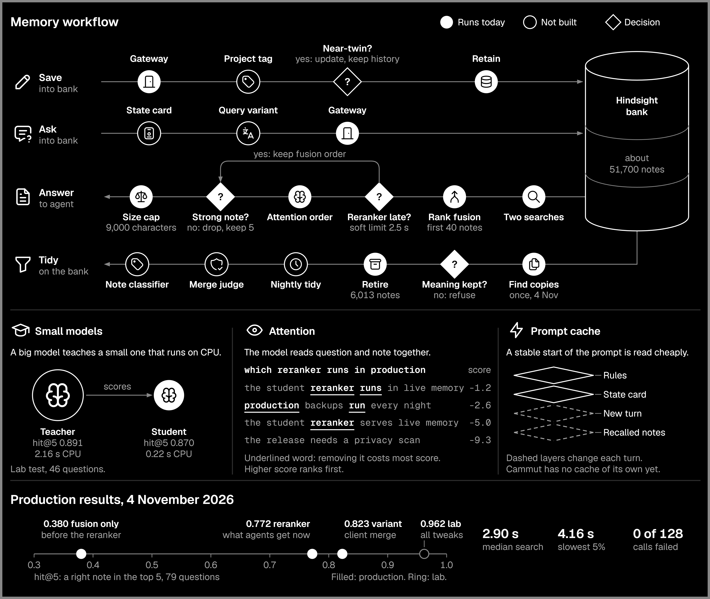

<p align="center">
  
</p>

# Cammut

Cammut gives every AI agent one shared memory and one door to its tools. You register your MCP servers once, give each agent a scoped token, and each agent reaches everything through one endpoint with four small tools: `cammut_servers`, `cammut_search`, `cammut_describe` and `cammut_call`.

It is a single Go binary with a web console. Secrets stay encrypted on your own server, and Cammut itself never calls a language model.



## Memory

Agents save notes through the gateway and ask for them through the same gateway. Hindsight stores the notes. The search runs by meaning and by keyword, and a small reranker orders the results. [docs/memory.md](docs/memory.md) describes the workflow, the decisions and the measured results.

## Install

You need a Linux server with Docker. Build the image, create the vault key, then start the service:

```bash
sudo install -d -m 700 /root/private
docker compose -f deploy/compose.yaml build
sudo docker run --rm --user 0:0 -v /root/private:/keys --entrypoint /cammut \
  cammut:0.4.0 admin vault-init -key /keys/cammut-vault.key
sudo chown 65532:65532 /root/private/cammut-vault.key
docker compose -f deploy/compose.yaml up -d
```

Back up the vault key somewhere separate. Without it, every stored secret is unreadable.

Create your console account in the terminal, so the password never crosses the web:

```bash
docker compose -f deploy/compose.yaml run --rm -it cammut admin create -username you
```

[The quickstart](site/content/docs/quickstart.md) covers HTTPS, the first token and the first connected agent.

## Agents

Each agent gets its own token, limited to the tools you choose. Connect it to `/mcp` on your host. The adapters in [adapters](adapters) add memory hooks for Claude Code and Codex.

## Public sign-in

The [edge](edge) folder holds a Cloudflare Worker for AI apps that need OAuth. It signs a person in, shows a consent page and passes each call to Cammut with a signed pass that lasts 60 seconds. Self-hosted use does not need it.

## Documentation

- [Concepts](site/content/docs/concepts.md)
- [Install](site/content/docs/install.md)
- [Agents](site/content/docs/agents.md)
- [Memory](site/content/docs/memory.md)
- [Archive](site/content/docs/archive.md)
- [Operations](site/content/docs/operations.md)
- [Security](site/content/docs/security.md)
- [Reference](site/content/docs/reference.md)
- [Limits](site/content/docs/limits.md)

## Development

Run the same checks as the continuous integration:

```bash
go test ./...
node --test "adapters/**/*.test.mjs" "deploy/*.test.mjs"
(cd web && npm ci && npm test && npm run build)
(cd edge && npm ci && npm test)
node scripts/privacy-scan.mjs --root . --skip-tests
```

[CONTRIBUTING.md](CONTRIBUTING.md) explains how to send a change, and [SECURITY.md](SECURITY.md) explains how to report a problem.

## Licence

Cammut is under the GNU Affero General Public License, version 3 only. See [LICENSE](LICENSE) and [NOTICE](NOTICE).
