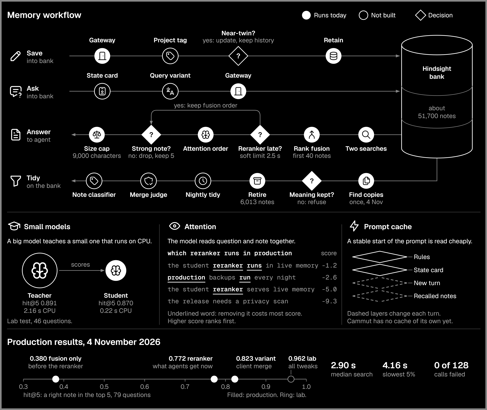

<!-- version: 1 | date: 2026-11-05 -->
# Memory

Cammut gives every agent one shared memory. Agents save notes through one gateway and ask for them through the same gateway. Hindsight stores the notes. Cammut itself never calls a language model.

## Workflow

An agent saves a note through the gateway. Hindsight turns it into facts and summaries.

An agent asks a question through the gateway. Hindsight searches two ways, by meaning with bge-m3 and by keyword. It merges the two lists by rank and keeps the first 40 notes.

A small reranker then reads the question and each note together and orders them again. If the reranker is late or fails, the merged order stays. On Claude Code, a laptop step then drops weak notes and caps the answer at 9,000 characters. It keeps at least 5 notes.

## Decisions

These decisions run today:
- All memory traffic goes through one gateway.
- The store stays Hindsight. We add to it and do not replace it.
- The reranker is a small student model on CPU, with rank fusion as the fallback.
- We retire a near-copy only when the two notes share 70% of their words, have equal negation words and no number is lost. An exact copy goes too.
- Every retired note stays in the archive, and the retirement can be undone.

These decisions are targets, and nothing here is built yet:
- A Russian question also searches with an English variant. The agent writes the variant, because Cammut calls no models.
- A note gets its project name from the main repository folder.
- An agent reads one state card, a short summary of a project, at session start.
- A near-twin updates the old note and keeps the history.
- A nightly job proposes merges with the same guard. A small judge model refuses a merge that loses a number, a date or a "not".
- The prompt keeps a stable start, so the provider's prompt cache can reuse it, and sends each note once.

A model enters only when it beats the simple method on held-out questions.

## Production results

Measured on the live system on 4 November 2026, on 79 test questions. Hit@5 means the share of questions with a right note in the top 5.

| Measure | Result |
|---|---|
| Hit@5, rank fusion only | 0.380 |
| Hit@5, with the reranker, what agents get today | 0.772 |
| Hit@5, with the English variant merged by the client | 0.823 |
| Median search time | 2.90 s |
| Slowest 5% of searches | 4.16 s or more |
| Slowest search | 6.83 s |
| Failed calls | 0 of 128 |
| Notes in the bank | 58,976 before clean-up, about 51,700 after |
| Notes retired | 6,013 |

Limits of these numbers:
- We wrote the questions ourselves, so real questions may score lower.
- One run differs from the next by about 2 questions.
- The 0.380 run came before the clean-up, so it does not compare exactly with 0.772.
- The test score stayed 0.823 before and after the clean-up, but the 109 answer notes were protected from retirement. So this test cannot show a loss of those notes.
- The reranker has a 2.5 s limit, and the limit does not fully hold, because the client retries by itself.
- The laptop step covers Claude Code only.

## Lab results

These come from the lab, not from production.

| Test | Result |
|---|---|
| Teacher bge-reranker-v2-m3, 46 questions | hit@5 0.891, 2.16 s CPU per question |
| Student model, 46 questions | hit@5 0.870, 0.22 s CPU per question |
| All tweaks together, 79 questions | hit@5 0.962 |

The 0.962 includes tweaks written by someone who knew the questions, and a changed answer key. Without the answer key it is 0.924. New questions must confirm it.

## Licence

Cammut, this document and the design decisions written in it are under the GNU Affero General Public License, version 3. See `LICENSE` and `NOTICE`.

A licence covers the code and the text. It does not cover an idea itself.

The model weights are not in this repository.
